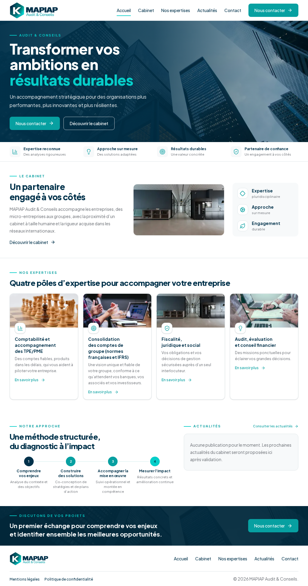
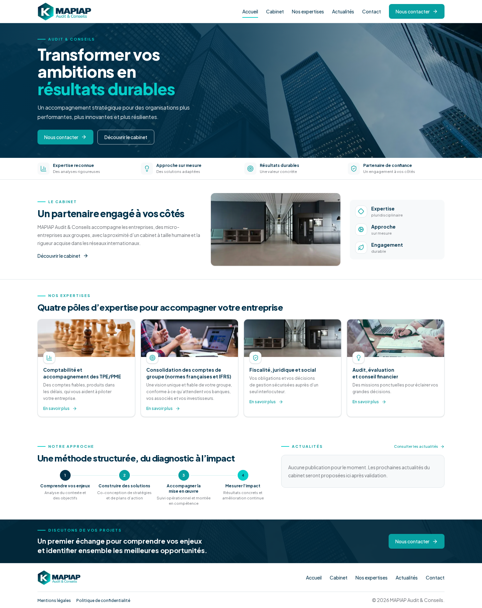
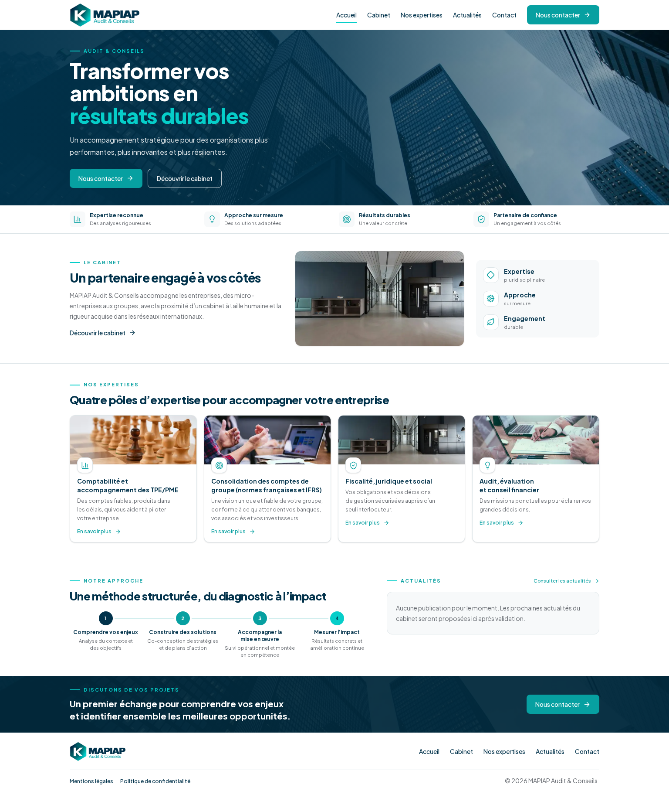
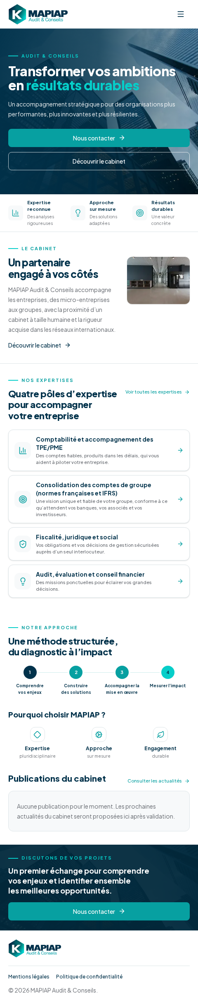
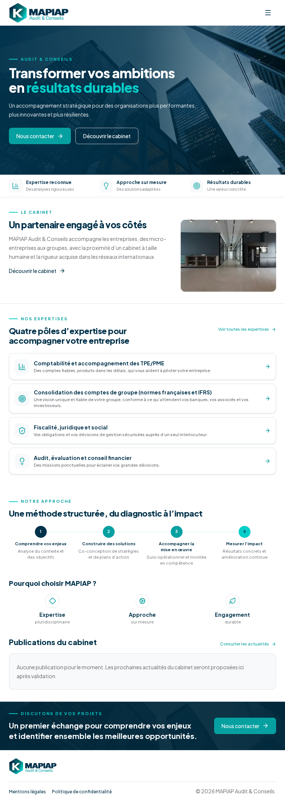
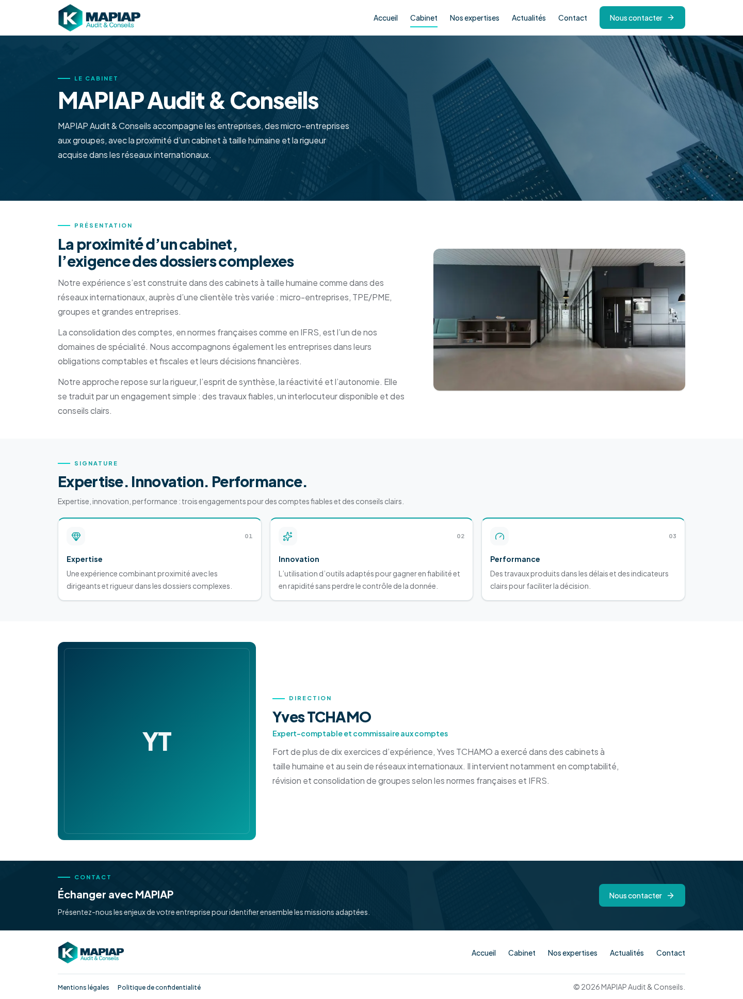

# R1 - Revue visuelle client MAPIAP

**Source unique des images :** snapshots Playwright Chromium Linux de la PR [#39](https://github.com/tawounfouet/mapiap-web/pull/39), SHA `c0bcaf9eb31dd4c8313677597e063c4cabb32a58`.
**Verification automatique :** [CI 44622294955](https://github.com/tawounfouet/mapiap-web/actions/runs/44622294955) : SUCCESS.
**Validation visuelle humaine :** A RECUEILLIR. L'existence de captures n'est pas un accord client.

## 1. Accueil - ordinateur

Questions a Yves : la promesse correspond-elle a son activite ? les quatre domaines ont-ils le bon ordre et la bonne importance ? le CTA est-il explicite ? les images d'immeubles sont-elles adaptees ?

### ACC-D-1024 - 1024 px

[Ouvrir le PNG pleine taille](assets/screenshots/accueil-desktop-1024.png)

### ACC-D-1440 - 1440 px

[Ouvrir le PNG pleine taille](assets/screenshots/accueil-desktop-1440.png)

### ACC-D-1536 - 1536 px

[Ouvrir le PNG pleine taille](assets/screenshots/accueil-desktop-1536.png)

## 2. Accueil - tablette et mobile

Verifier : menu accessible, lisibilite des quatre cartes, absence de debordement, absence de fausses actualites, section contact et pied de page.

### ACC-M-0320 - 320 px

[Ouvrir le PNG pleine taille](assets/screenshots/accueil-mobile-320.png)

### ACC-M-0390 - 390 px

[Ouvrir le PNG pleine taille](assets/screenshots/accueil-mobile-390.png)

### ACC-M-0480 - 480 px

[Ouvrir le PNG pleine taille](assets/screenshots/accueil-mobile-480.png)

### ACC-T-0768 - 768 px

[Ouvrir le PNG pleine taille](assets/screenshots/accueil-tablette-768.png)

## 3. Cabinet - ordinateur et mobile

Verifier : presentation fidéle au texte fourni le 08/11, trois piliers de marque, photographie institutionnelle, biographie et CTA. Le visuel `YT` est un placeholder, pas le portrait final. Le titre professionnel exige une verification distincte.

### CAB-D-1440 - 1440 px

[Ouvrir le PNG pleine taille](assets/screenshots/cabinet-desktop-1440.png)

### CAB-M-0390 - 390 px

[Ouvrir le PNG pleine taille](assets/screenshots/cabinet-mobile-390.png)

## 4. Expertises - preuves visuelles non encore produites

Le repo fournit des tests E2E fonctionnels sur les 4 slugs, mais aucun snapshot PNG des pages Expertises n'existe dans le jeu de neuf images de la PR #39. Ne pas utiliser de maquette generique a leur place.

Preuves attendues avant presentation du dossier comme complet :

- [ ] `/expertises` a 1440 px et 390 px.
- [ ] `/expertises/comptabilite-accompagnement-tpe-pme` a 1440 px.
- [ ] `/expertises/consolidation-comptes-groupe` a 1440 px.
- [ ] `/expertises/fiscalite-juridique-social` a 1440 px.
- [ ] `/expertises/audit-evaluation-conseil-financier` a 1440 px.

Produire ces captures sur un build de production issu du SHA de la PR #39, en navigateur Chromium, avec URL, taille de viewport et contenu visible. Les joindre sous `assets/screenshots/expertises-*.png` et actualiser le manifeste et le PV. Ne jamais nommer un PNG produit localement « approuve » sans validation du client.

## 5. Grille de relecture a renseigner

- [ ] Logo, couleurs et typographie acceptes (RC-010).
- [ ] Bandeau et message Accueil acceptes (RC-003).
- [ ] Quatre titres et perimetres acceptes (RC-005).
- [ ] Cabinet et trois piliers acceptes (RC-004).
- [ ] Biographie et titres d'Yves approuves et justifies (RC-004 / RC-012).
- [ ] Portrait reel integre et droit d'utilisation confirme (RC-011).
- [ ] Rubrique Actualites vide ou masquee : choix explicite (RC-006).
- [ ] Toutes les vues Expertises produites et inspectees.

## 6. Relevé des retours

Pour chaque retour d'Yves : `UAT-ID | element | changement demande | raison | criticite | decision | date | version du texte ou du PNG | Issue`. Le registre de validation est [ici](R1_MAPIAP_CLIENT_VALIDATION_REGISTER.md).
